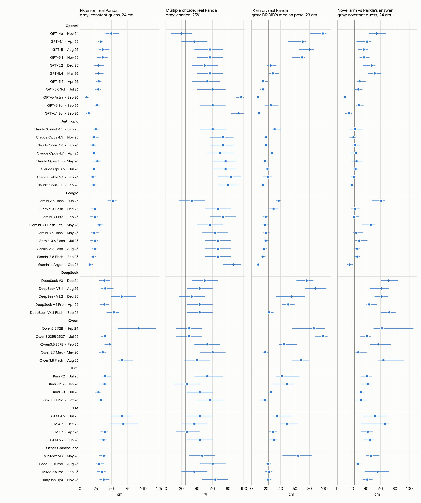

# Are frontier VLMs trained on robotics specific data ?

We measure this question by comparing the difference in model performance on Franka Panda kinematics and synthetically generated kinematics. We preform this analysis across 50 open and closed source models. 



- `prompts.md`: the system prompts and example prompts
- `data/<run>/tasks.jsonl`: every individual prompt with its ground truth answer
- `data/<run>/rollouts/`: every rollout
- `plot/make_plots.py`: plotting code `figures/`

```
pip install -r requirements.txt
python plot/make_plots.py
```

Joint angles are sampled from [DROID](https://droid-dataset.github.io/). Models were queried through OpenRouter in November 2026.
